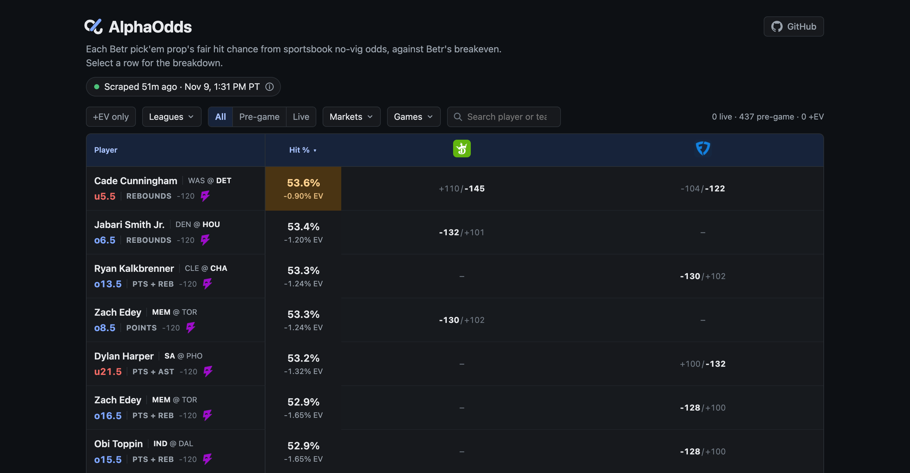
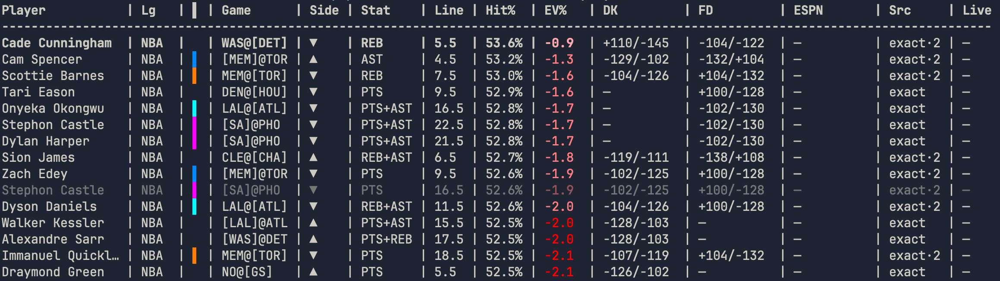

# AlphaOdds

[](https://github.com/jjaydenli/ev-sports-tracker/actions/workflows/ci.yml)

**Live board: https://alphaodds.vercel.app** (the latest scheduled scrape, refreshed four times a day)



*Ranked plays from the latest scrape. The status pill shows when it ran and whether every source succeeded.*

Finds +EV (positive expected value) player prop bets by comparing fixed-payout DFS lines (Betr) against sharp sportsbook prices. A Python pipeline scrapes, normalizes, and de-vigs three sportsbooks with undocumented APIs (DraftKings, FanDuel, and theScore Bet, formerly ESPN BET) and ranks opportunities by edge; a FastAPI and Next.js board publishes the results.

## Technical highlights

- **API reverse engineering**: all three sportsbooks have unpublished APIs. theScore Bet uses GET-based GraphQL persisted queries with an encrypted JWE bearer token (minted anonymously via a `Startup` op; cached and reactively re-minted on 401). DraftKings and FanDuel use undocumented REST endpoints discovered through DevTools captures.

- **De-vig algorithm for one-sided markets**: sportsbooks offer milestone props (`N+` over-only) with no paired under, making standard two-sided de-vigging impossible. When a contiguous `N+` ladder exists, the engine renormalizes the vig-inflated survival curve `S(N) = P(X≥N)` back to fair probability mass. Falls back to hold-shrink when only a lone threshold is available.

- **Match-context resolution**: props across books are matched on a canonical key `player|market|league|game|event_hour|live` where `event_hour` is the UTC hour-floor of game start. This eliminates cross-day ladder drift (e.g. a player listed for tomorrow's game being priced against today's Betr prop) and disambiguates MLB doubleheaders without special-case logic.

- **Data-driven book registry**: a `SharpBookConfig` dataclass drives all resolution logic (O/U interpolation strategy, milestone fallback, hold estimation). A fourth sportsbook needs a scraper, a parser, and one registry entry; no edits to resolution code.

## How it works

```
Betr (DFS)    ──┐
DraftKings    ──┤──▶  normalize  ──▶  match-context filter  ──▶  per-book resolve  ──▶  ranked +EV output
FanDuel       ──┤                         (canonical key)          (de-vig + ladder)
theScore Bet  ──┘
```

Each run scrapes all configured sources in parallel, normalizes to a shared `NormalizedProp` schema, then for each Betr prop filters the sharp pool to the same game snapshot before building O/U or milestone ladders. Multi-book consensus runs when two or more books price the same line exactly.



*Ranked output from `./ev` on an NBA slate where no line cleared 0% EV, so every row is negative. `[TEAM]` is the player's team, a shared color bar marks teammates (a correlated stack), a dimmed row is a player's weaker duplicate, and `exact·2` means two books quoted the exact line. ESPN is empty because theScore Bet is scraped for MLB and WNBA only.*

Architecture decisions: [`docs/design/`](docs/design/)

## How the live board works

```
External cron (4x/day)
  │ workflow_dispatch
  ▼
GitHub Actions                 ──▶  FastAPI (Render)  ──▶  Postgres (Neon)  ◀──  Next.js page (Vercel, ISR)
  ./ev --top-n all --books dk,fd      POST /api/runs        board_runs table        GET /api/board
  python -m web.publish
```

A workflow (`.github/workflows/live-board.yml`) runs the pipeline four times a day and posts the run with `web.publish`. An external cron triggers it on time, since GitHub's scheduler delays on-the-hour runs; the built-in schedule is a backup that skips when the board is fresh. The live board prices DraftKings and FanDuel only, since theScore Bet blocks requests from cloud runners. A run replaces the board only if `./ev` exited 0 with at least one row, so a failed or empty run never overwrites the last good board. The page is statically generated and revalidated every five minutes, so visitors never wait on the API waking up.

## Setup

Requires Python 3.13. `./ev` needs Betr credentials (below); the sportsbooks need none.

```bash
cd backend
python -m venv .venv && source .venv/bin/activate
pip install -r requirements.txt
cp config/.env.example config/.env   # fill in credentials; never commit this file
```

**Betr auth:** set `BETR_REFRESH_TOKEN` + `BETR_KEYCLOAK_TOKEN_URL` (from DevTools on login). Probe: `python -m scrapers.dfs.betr.betr_auth --try-grant`. See [`docs/betting_odds/betr.md`](docs/betting_odds/betr.md).

```bash
pytest -q   # 750+ tests, offline fixtures only
```

## Usage

From the repo root (activates `backend/.venv` automatically):

```bash
./ev
```

Runs all configured leagues (NBA, MLB, WNBA): parallel scrape → normalize → EV scan. Output written to `backend/data/processed/`:

| File | Contents |
|------|----------|
| `ev_opportunities.json` | Ranked plays, best EV first (default top 15) |
| `ev_run_diff.json` | New / removed / improved vs previous run |
| `match_report.json` | Match rates by league and source |
| `scrape_coverage.json` | Per-source scrape status |
| `unmatched_betr.json` | Betr lines with no sharp match |

**Useful flags:**

```bash
./ev --mlb                      # MLB only
./ev --books dk,espn            # subset of sharp books
./ev --top-n 25 --min-ev 0.02   # top 25 with EV >= 2%
./ev --top-n all                # every ranked row (the live board adds --books dk,fd)
./ev --scrape-only              # scrape + normalize, skip EV
./ev --live-only --nba          # in-progress games only (skips pregame and FanDuel)
./ev --timing                   # wall-clock summary per pipeline stage
```

Platform-specific API notes: [`docs/betting_odds/`](docs/betting_odds/)

## Repository layout

```
ev-sports-tracker/
├── ev                    # entry point → backend/core/pipeline_runner.py
├── .github/workflows/    # ci.yml (tests, lint, types), live-board.yml (scheduled scrape)
├── frontend/             # Next.js live board page
│   ├── app/              # page (revalidates every 5 min), layout, error page
│   ├── components/       # board table, status pill, tooltips
│   └── lib/              # board API client, field and book metadata
└── backend/
    ├── config/           # SharpBookConfig registry, market maps, headers, league/source registry
    ├── scrapers/         # Betr (DFS) and DraftKings / FanDuel / theScore Bet engines
    ├── parsers/          # per-book parsers → shared NormalizedProp schema
    ├── core/             # ladders, de-vig math, resolution, EV engine, CLI orchestrator
    ├── web/              # board API (FastAPI), run store, publisher
    └── tests/            # unit tests on captured API payloads (no live network)
```

## Security

Credentials load from `config/.env` via `os.getenv()`; nothing is hardcoded, and `.env` files are gitignored.
